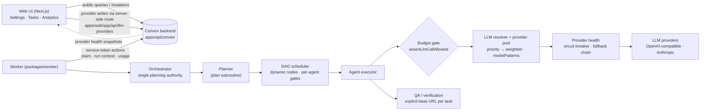

# MOAgent

Multi-agent orchestrator: a planner builds a DAG of subtasks, agents execute
them (code change, review, QA, audit/research), file changes go through a
human approval gate, and results are verified before a task is marked done.

Workspaces:

- `apps/web` — Next.js UI (`@moagent/web`)
- `apps/api` — Convex backend (`@moagent/api`, code in `apps/api/convex`)
- `packages/worker` — the worker that claims and executes tasks (`@moagent/worker`)
- `electron/` — optional desktop shell

## Architecture



- **Planning authority.** One brain decides: the orchestrator owns
  execution decisions and flow; the planner is its subroutine that builds
  the `ExecutionPlan` the scheduler actually runs (behind the
  `ORCHESTRATOR_AUTHORITATIVE` flag, default on). Post-execution
  evaluations act inside the same scheduler invocation: APPROVE spawns a
  real delegation subtask, REVISE (non-review) spawns a fix subtask with
  structured findings, BLOCKED halts new scheduling gracefully. Dynamic
  subtasks are persisted, so recovery does not lose them.
- **LLM resolver & provider pool.** Provider *connections*
  (`llmProviders`) are separate from the *model registry* (`llmModels`):
  one connection offers many models, and each agent may prefer a
  provider/model with a fallback assignment. Selection consumes priority,
  then weighted choice among equals, filtered by `modelPatterns` and by
  health: a per-connection circuit breaker (3 consecutive transient
  failures → 60 s open → half-open probe) excludes failing connections,
  and the next candidate in the fallback chain serves the same task.
- **Credential security.** Provider keys are encrypted at rest with
  AES-256-GCM (`PROVIDER_ENCRYPTION_KEY`, see Setup §2). Plaintext exists
  only transiently: writes encrypt before storing, public queries return
  only `apiKeyConfigured`, and the worker receives ciphertext and decrypts
  on its side. Legacy agent key fields never leave the backend.
- **Execution reliability.** Per-agent concurrency gates, a two-tier LLM
  concurrency gate (per-task + worker-wide), one `AbortController` per
  task (user cancel and the task deadline share it) threaded into LLM
  calls, QA, commands and verification, permanent-vs-transient retry
  classification with a budget/deadline veto, stale-task recovery that
  requeues tasks with a valid checkpoint (bounded), and a backend
  write-layer guard: once a task reaches a terminal status, late
  completions are refused with a value, never applied.
- **Budget enforcement.** One `BudgetTracker` per task gates every LLM
  call *before* it happens (`canCallLLM` + token budget). Exhaustion in
  `enforce` mode ends the task with a `budget.exhausted` event and
  preserves completed outputs; the shipped default is `budgetMode:
  "warn"` (set `ORCHESTRATOR_BUDGET_MODE=enforce` to hard-stop), which
  emits a warning event and lets the run continue. Usage is recorded per
  agent, per provider and per model, with `estimatedCost` computed only
  when registry pricing exists — never guessed.
- **Observability.** Token usage aggregates by agent / provider / model
  in Analytics; provider circuit state is mirrored to the backend and
  rendered as a health badge per connection in Settings; delegation
  metrics come from the real `delegations` table. There is no separate
  tracing system — the existing `taskEvents` / lifecycle history is the
  trail.

## Setup

```bash
git clone <this repo>
cd MOAgent
npm install
```

### 1. Convex backend (one-time login + codegen)

The Convex generated client (`apps/api/convex/_generated/`) is **gitignored**
and does not exist in a fresh clone. Without it, typecheck and the backend
cannot run. Generate it once:

```bash
npx convex dev
```

This opens a browser login (Convex account), links or creates a deployment,
writes `NEXT_PUBLIC_CONVEX_URL` to `.env.local`, and generates
`convex/_generated/`. Leave it running while you develop — it also pushes
schema/function changes live. For a fully local backend, `npx convex dev`
offers an anonymous local deployment instead of a cloud one.

### 2. Environment

Create a root `.env` (the worker loads `../../.env` relative to
`packages/worker`). Variable names only — never commit real values:

```bash
NEXT_PUBLIC_CONVEX_URL=   # written by `npx convex dev`
CONVEX_SERVICE_TOKEN=     # shared secret between worker and backend actions
PROVIDER_ENCRYPTION_KEY=  # base64 32-byte key for provider-key encryption (see §2b)
LLM_PROVIDER=             # e.g. anthropic | openai-compatible
LLM_MODEL=                # fallback model when no provider is set in Settings
LLM_BASE_URL=             # fallback base URL (OpenAI-compatible endpoint)
LLM_API_KEY=              # fallback API key; per-provider keys live in Settings
WORKSPACE_ROOT=./workspaces
```

### 2a. Browser QA (Chromium)

Browser QA is **on by default** (`ORCHESTRATOR_QA_MODE=auto`): after changes
are applied and verified (tsc/lint/test), QA opens the app in Chromium when
the change touches UI or you ask for QA/e2e/browser testing. Install the
browser once on every worker machine:

```bash
cd packages/worker && npx playwright install chromium   # add --with-deps on Debian/Ubuntu
```

On linux-arm64 Playwright's CDN has no Chromium build: install a system
Chromium and set `QA_CHROMIUM_PATH=/path/to/chromium` (also honoured:
`PLAYWRIGHT_CHROMIUM_EXECUTABLE_PATH`). `--no-sandbox` is added when running
as root or in a container, or with `QA_CHROMIUM_NO_SANDBOX=1`. Without a
browser, QA is reported as skipped ("blocked") and the task still completes,
unless `ORCHESTRATOR_QA_REQUIRED=1`. Set `ORCHESTRATOR_QA_MODE=never` to turn
browser QA off. See `packages/worker/AGENTS.md` for all QA variables.

The LLM provider used per task is normally configured in the web UI
(Settings -> LLM providers, stored in the `llmProviders` table); the `LLM_*`
env values are only the fallback when no provider row exists.

### 2b. Provider encryption key + deploying backend updates

Provider API keys are encrypted at rest (AES-256-GCM). The encryption key
lives **outside** the database and must be set, with the **same value**, in
two places: the Convex deployment env (encrypts on write) and the worker
env (decrypts on use). If the two differ, every provider call fails with
an explicit decryption error naming the provider.

```bash
# 1. Generate the key once (keep it somewhere safe; losing it means
#    re-entering every provider key)
openssl rand -base64 32

# 2. Set it on the Convex deployment
cd apps/api
npx convex env set PROVIDER_ENCRYPTION_KEY <the generated value>

# 3. Set the same value in the worker's environment (root .env)
#    PROVIDER_ENCRYPTION_KEY=<the generated value>
```

Deploying backend changes and running the credential migration — required
once after upgrading to the encrypted schema, and the deploy step after
any later backend change:

```bash
cd apps/api
npx convex dev        # dev: watch + push functions/schema (or `npx convex deploy` for a hosted deployment)

# Encrypt existing plaintext provider keys + build the model registry
# (idempotent — safe to run again; also clears legacy agent key fields)
npx convex run migrations:migrateProvidersAndAgents

# Verify: reports zero plaintext keys remaining
npx convex run migrations:verifyMigration
```

Restart the worker after a backend deploy so it picks up the new
contracts. Key rotation, when needed:
`npx convex run migrations:rotateEncryptionKeys` with the new key already
set as above — it re-encrypts every stored key.

## Authentication & security limitations

MOAgent is currently a **single-user, local-development prototype**. There
is deliberately **no login and no rate limiting** — that is an accepted
decision by the owner for this prototype, not an oversight — and it must
not be exposed to an untrusted network as-is. The concrete model today:

- **Ownership is conditional.** Project ownership (`projects.ownerId`) is
  enforced only when a project carries an `ownerId` *and* a viewer identity
  exists (`apps/api/convex/authz.ts`). Projects without an owner — every
  project in local mode — are accessible to anyone who can reach the
  deployment.
- **Worker ↔ backend** calls use one static shared secret,
  `CONVEX_SERVICE_TOKEN`. The comparison is timing-safe and fails closed
  when unset, but the token is not bound to a worker id and there is no
  rotation mechanism.
- **Provider administration is token-gated.** The `llmProviders`
  create/update/remove mutations require the service token. The Settings UI
  calls them through a server-side Next route
  (`apps/web/app/api/llm-providers`) that holds the token in the web
  server's environment — so the web server needs `CONVEX_SERVICE_TOKEN`
  set (server-side only, never a `NEXT_PUBLIC_*` variable) for Settings
  writes and model discovery to work. Provider read queries are public but
  never return the key (only `apiKeyConfigured`).
- **Credentials are encrypted at rest.** Provider API keys are stored
  only as AES-256-GCM ciphertext (`apiKeyCiphertext`); see Setup §2b for
  the key setup and the one-time migration
  (`migrations:migrateProvidersAndAgents`, verified by
  `migrations:verifyMigration` reporting zero plaintext). Until that
  migration has been run on a deployment, pre-upgrade rows may still hold
  plaintext — run it before trusting a deployment. Internal run contexts
  strip the legacy agent key fields before anything reaches the worker,
  only ciphertext crosses to the worker (it decrypts locally), public
  queries return only `apiKeyConfigured`, and the browser never sends a
  provider key to a provider base URL directly (model discovery runs on
  the backend).

### 3. Run

```bash
npm run convex     # terminal 1: Convex dev + worker
npm run dev        # terminal 2: web UI on http://localhost:3000
```

Or run the pieces separately: `npm run worker`, plus `npx convex dev` inside
`apps/api`.

### 4. Verify

```bash
npm test           # worker unit/integration tests (vitest)
npm run --workspace=@moagent/api test   # backend tests (convex-test, in-memory — no deployment needed)
npm run typecheck  # web + api + worker (requires step 1: _generated)
```

`npm test` does not need Convex codegen. `npm run typecheck` fails in
`apps/api` and `packages/worker` until `convex/_generated/` has been
generated at least once — that is expected on a fresh clone, not a code
error.
